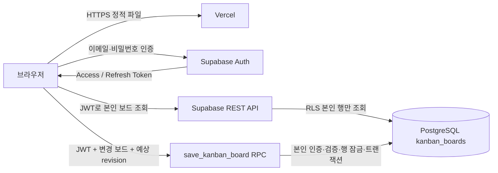

# 개인 칸반보드 아키텍처

## 1. 목표와 변경 범위

기존 단일 로컬 HTML의 화면을 유지하면서 HTML/CSS/JavaScript를 분리했습니다. Vercel은 정적 파일을 제공하고 Supabase Auth는 계정을, Supabase PostgreSQL은 카드 데이터를 보관합니다. 카드 생성·수정·삭제·상태 변경·순서 변경·백업 복원은 모두 데이터베이스 저장 대상입니다. 이전 HTML 파일은 수정하지 않았습니다.

이 패키지는 배포 가능한 소스이며 실제 Vercel/Supabase 계정에 연결하거나 배포를 완료한 결과는 아닙니다. 프로젝트 URL과 공개 키 설정, SQL 실행 후 배포해야 합니다.

## 2. 구성

별도 애플리케이션 서버, 프레임워크 또는 SDK 의존성은 없습니다. 브라우저의 fetch로 Supabase Auth/REST API를 호출합니다. 카드 데이터의 영구 저장소는 Supabase이며 localStorage, sessionStorage, IndexedDB를 사용하지 않습니다. 화면을 그릴 때만 카드 사본이 메모리에 존재합니다. 사용자가 명시적으로 누르는 JSON 백업은 로컬 다운로드입니다.

## 3. 파일별 책임

| 파일 | 역할 |
|---|---|
| index.html | 로그인 폼, 보드, 카드 편집 대화상자의 구조 |
| styles.css | 반응형 레이아웃·카드·로그인 화면 스타일 |
| app.js | 인증, 렌더링, 카드 편집/이동, 검증, 백업/복원, Supabase API 호출 |
| config.js | 직접 정적 실행할 때 사용하는 공개 URL/키 설정 |
| build.mjs | Vercel 환경변수로 dist/config.js 생성 및 정적 파일 복사 |
| package.json | Vercel 빌드 명령 정의 |
| vercel.json | 빌드·출력 경로 및 기본 보안 헤더 |
| schema.sql | 테이블, RLS 조회 정책, 저장 RPC와 권한 |
| .env.example | Vercel에 등록할 환경변수 이름 예시 |
| ARCHITECTURE.md | 이 설계와 설정·배포·검증 가이드 |

HTML 안에는 일부 간단한 기존 표시용 inline style이 남아 있으며 주 스타일 정의는 styles.css에 분리했습니다.

## 4. 인증과 권한

- 이메일/비밀번호 회원가입과 로그인을 지원합니다. 비밀번호는 Supabase Auth로만 전송하며 애플리케이션에서 저장하지 않습니다.
- 이메일 확인이 켜져 있으면 확인 이메일의 링크를 누르고 서비스로 돌아와 로그인합니다. 인증 확인 링크의 토큰을 앱 세션으로 자동 교환하지는 않습니다.
- Access/Refresh Token은 메모리에만 보관합니다. 문서 새로고침·탭 종료 시 다시 로그인해야 합니다. 앱 내부의 ‘새로고침’ 버튼은 로그인 상태를 유지하며 서버 데이터만 다시 읽습니다.
- 로그인 세션은 만료 약 60초 전에 갱신합니다. 갱신 실패 시 로그인 화면으로 돌아갑니다.
- 조회에는 RLS `auth.uid() = user_id`가 적용됩니다. 익명 조회는 허용되지 않습니다.
- authenticated 역할에 직접 INSERT/UPDATE/DELETE 권한을 부여하지 않습니다. 저장은 인증된 사용자만 실행 가능한 RPC를 통합니다.
- RPC는 SECURITY DEFINER이지만 빈 search_path, 스키마 명시, `auth.uid()` 검사, 사용자 ID 입력 매개변수 부재로 본인 행만 변경합니다. 이 함수는 RLS 대신 함수 안에서 소유권을 강제하므로 이 검사를 제거하면 안 됩니다.
- 프로젝트 URL과 publishable key는 공개 가능한 프런트엔드 설정입니다. 공개 키만으로 안전한 것이 아니라 RLS 및 RPC 권한이 안전성을 보장합니다.
- **service_role 키, sb_secret_ 키, DB 비밀번호는 어떤 프런트엔드 파일이나 환경변수에도 넣지 마세요.**

## 5. 데이터 모델

보드 하나를 사용자별 단일 JSONB 행으로 저장합니다. 별도 카드 테이블에 카드별 행을 저장하는 방식은 아닙니다. 개인용 보드의 순서·일괄 복원을 한 번의 트랜잭션으로 저장하려는 선택입니다.

### public.kanban_boards

| 열 | 형식 | 의미 |
|---|---|---|
| user_id | uuid PK/FK | auth.users.id, 계정 삭제 시 보드 삭제 |
| tasks | jsonb array | 카드 목록 |
| revision | integer | 낙관적 동시성 제어 버전 |
| updated_at | timestamptz | DB 최종 저장 시각 |

카드: `id`, `title`(1~160자), `description`(최대 10,000자), `status`(todo/doing/done), `priority`(low/medium/high), `due`(YYYY-MM-DD 또는 빈 문자열), `created`(클라이언트 생성 시각 밀리초), `order`(정렬 숫자).

조회 시 보드 행이 없으면 빈 보드/revision 0으로 취급합니다. 최초 저장에서 행을 생성합니다. 서버는 목록 형식, 필수 키, 고유 ID, 문자열 길이, 상태/우선순위, 날짜와 숫자를 검증합니다. 보드당 최대 10,000개 카드, 저장 JSON 최대 20MB 제한이 있습니다. 실제 운영에서는 이 한도에 도달하기 훨씬 전에 카드별 행과 페이지네이션으로 전환하는 것이 좋습니다.

## 6. 저장 흐름과 충돌 처리

1. 로그인 후 RLS를 통해 본인 보드와 revision을 조회합니다.
2. 사용자가 카드를 변경하면 변경 목록을 메모리에 만들고 저장 RPC를 호출합니다.
3. 요청 중 주 화면과 편집 입력을 잠가 중복 변경을 막습니다.
4. RPC는 행 잠금 후 DB revision과 클라이언트 예상 revision을 비교합니다.
5. 일치하면 전체 보드를 트랜잭션으로 교체하고 revision을 1 증가시킵니다.
6. 성공 응답 후 ‘Supabase 저장 완료’를 표시합니다.
7. 실패하면 화면 데이터를 마지막 확인된 사본으로 돌리고 오류를 알립니다. 폼 저장 실패 시 대화상자 입력은 남습니다.
8. 다른 기기/탭이 먼저 저장하면 BOARD_CONFLICT 오류가 발생합니다. 새로고침 버튼으로 최신 데이터를 읽고 다시 변경합니다. 자동 병합이나 실시간 구독은 구현하지 않았습니다.

네트워크 연결이 응답 도중 끊기면 DB에는 반영됐지만 클라이언트가 실패로 판단할 수 있습니다. 이때 새로고침 버튼으로 서버 결과부터 확인하세요. 오프라인 저장 큐나 자동 재시도는 없습니다. 전체 JSON 저장이므로 카드가 매우 많아지면 요청 크기와 지연이 증가합니다.

## 7. Supabase 설정

1. Supabase 프로젝트를 만듭니다.
2. SQL Editor에서 `schema.sql`을 한 번 실행합니다. 새 객체를 생성하는 스크립트이며 기존 테이블을 삭제하지 않습니다. 같은 이름의 객체가 있으면 먼저 검토하세요. 재실행용 마이그레이션은 아닙니다.
3. Authentication에서 이메일/비밀번호 가입을 활성화합니다. 이메일 확인은 활성화 유지 권장입니다.
4. Authentication의 URL Configuration에서 Site URL을 실제 Vercel 프로덕션 주소로 설정합니다. 허용 Redirect URLs에도 해당 주소를 추가합니다. 로컬 테스트 주소가 필요하면 정확한 로컬 주소도 별도로 추가합니다.
5. 프로젝트 Connect/API 설정에서 프로젝트 URL과 publishable key를 확인합니다. 기존 프로젝트의 공개 anon key도 지원하지만 service_role/secret 키는 금지입니다.
6. 실제 서비스의 이메일 전달은 Supabase의 이메일 제한 및 SMTP 설정을 별도 확인하세요.

이메일 확인 후 자동 로그인하지 않고 이메일/비밀번호 로그인을 다시 수행합니다. 비밀번호 재설정, 소셜 로그인, MFA, 계정 삭제 UI는 이번 범위에 포함하지 않았습니다.

## 8. Vercel 배포

### 권장: 환경변수 빌드

1. ZIP을 풀고 내용 파일들이 저장소 루트에 오도록 Git 저장소에 올립니다.
2. 기존 Vercel 프로젝트가 있으면 해당 저장소/브랜치에 반영합니다. 없다면 저장소를 Import합니다.
3. Framework Preset은 **Other**로 설정합니다. 빌드 명령 `npm run build`, 출력 폴더 `dist`를 사용합니다. 패키지 외부 의존성이 없어 추가 패키지 설치는 필요하지 않습니다.
4. Vercel 프로젝트 환경변수에 아래 두 값을 Production에 추가합니다. Preview 사용 시 Preview에도 별도로 설정합니다.
   - `SUPABASE_URL`: 프로젝트 HTTPS URL
   - `SUPABASE_PUBLISHABLE_KEY`: 공개 publishable 또는 공개 anon key
5. 배포합니다. 이미 배포돼 있다면 환경변수 설정 후 재배포해야 합니다.
6. 실제 배포 주소를 Supabase Site URL/Redirect URLs에 등록합니다.

build.mjs는 환경변수를 읽어 dist/config.js에 공개 설정을 만듭니다. **정적 JavaScript는 Vercel 환경변수를 실행 중 직접 읽지 못하므로 빌드 단계가 필요합니다.** dist에는 HTML/CSS/JS만 복사되며 SQL과 문서는 배포하지 않습니다.

### 로컬 개발 또는 수동 정적 호스팅

config.js의 예시 URL/키를 공개 설정으로 교체하고 로컬 정적 웹 서버로 루트 파일들을 제공하세요. config.js를 직접 수정하는 방식과 환경변수 빌드는 별개입니다. Vercel 빌드는 루트 config.js 대신 환경변수로 새 설정을 생성합니다. 파일 더블클릭은 인증과 HTTP 동작이 브라우저별로 달라 권장하지 않습니다. 이 버전은 Supabase와 인터넷 연결이 필요합니다.

## 9. 기존 로컬 데이터 이전

기존 단일 HTML에서 ‘백업’을 내려받습니다. 새 사이트에 로그인한 후 ‘백업 복원’으로 JSON 파일을 선택합니다. 현재 계정의 보드를 교체하므로 기존 보드를 먼저 백업하세요. 이전 localStorage 데이터는 새 앱에서 자동으로 읽지 않습니다.

## 10. 검증 체크리스트

- 계정 A 회원가입, 이메일 확인, 로그인, 카드 생성 후 앱 내 새로고침으로 유지 확인.
- 수정, 삭제, 우선순위, 마감일, 드래그 이동, 수동 순서 변경이 DB에 반영되는지 확인.
- 로그아웃 후 계정 B로 로그인했을 때 A의 카드가 보이지 않는지 확인.
- B의 JWT로 다른 user_id를 조회해도 행이 반환되지 않는지 확인.
- 직접 테이블 쓰기는 실패하고 RPC 쓰기만 허용되는지 확인.
- 서로 다른 두 탭에서 같은 계정으로 로그인해 같은 revision을 읽은 뒤 순서대로 저장 시 두 번째 저장이 충돌하는지 확인.
- 네트워크를 끊고 수정하면 저장 실패와 화면 되돌림이 표시되는지 확인.
- 백업/복원, 긴 문자열, HTML 태그 입력, 잘못된 JSON 처리 확인. 화면은 textContent 기반으로 사용자 문자열을 렌더링합니다.
- 모바일에서 상태 선택 메뉴로 카드 이동 확인. 모바일 터치 드래그는 브라우저별 지원 차이가 있습니다.

이번 산출물은 JS 문법, 파일 연결, 정적 빌드 및 충돌/롤백 알고리즘을 점검했습니다. 실제 Supabase 자격 설정, SQL 실행, 이메일 송수신, 실 브라우저와 Vercel 통합 실행은 연결 정보가 없어 수행하지 않았습니다.

## 11. 공식 참고 문서

- [Supabase Redirect URLs](https://supabase.com/docs/guides/auth/redirect-urls)
- [Supabase API Keys](https://supabase.com/docs/guides/api/api-keys)
- [Supabase Row Level Security](https://supabase.com/docs/guides/database/postgres/row-level-security)
- [Supabase REST API](https://supabase.com/docs/guides/api)
- [Vercel Project Configuration](https://vercel.com/docs/project-configuration)
